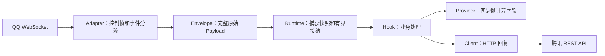

# QQ 官 Bot 接入与协议边界

本页描述当前 Adapter、Provider 和 Client 的实现：一个账号、一条 WebSocket 连接，处理 QQ 群聊、C2C、文字子频道及频道私信。文本业务使用 `ctx.reply()`，复杂消息使用 Client 的原始 JSON 接口；平台字段和权限参考 [官方消息概述](https://bot.q.qq.com/wiki/develop/api-v2/server-inter/message/overview.html)，实际可用场景需账号联调确认。

## 1. 安装与运行

在项目根目录执行：

```powershell
python -m pip install -e ".[qqofficial]"
```

编辑 [官 Bot 配置示例](../../examples/Tiffany.qqofficial.toml)，把 `app_id` 改为开发者后台的 AppID。将后台 AppSecret 放入当前终端的环境变量；不要把它写进 TOML：

```powershell
$env:TIFFANY_QQBOT_SECRET = "你的 AppSecret"
python -m examples.qqofficial
```

[示例入口](../../examples/qqofficial.py) 通过公开 API 组装 Bot、现有 Hook 和适配器，读取自己的示例配置文件。服务器使用 `bash start.sh configure` 选择 QQ，可扫码或手动输入；配置保存在 `data/config/Tiffany.toml`，密钥单独保存。`python main.py` 同样读取 data 配置，但不提供环境准备和重启监督。参见[服务器部署文档](deployment.md)。

| 配置项 | 默认值 | 作用 |
| --- | --- | --- |
| `app_id` | 必填字符串 | 应用身份，不是机器人用户 ID |
| `app_secret_env` | `TIFFANY_QQBOT_SECRET` | 保存 AppSecret 的环境变量名；缺失时启动前报错 |
| `sandbox` | `false` | 选择生产或沙箱 API 地址；能否收到消息取决于账号和场景的后台配置 |
| `workers` | 不设置 | 继承全局 Scheduler 并发；显式正整数可降低此适配器上限，全局额度仍生效 |
| `max_inflight` | `16` | QQ HTTP 调用的独立并发额度，不随事件并发扩大 |
| `call_timeout` | `30.0` 秒 | HTTP 调用总预算，包括 Token 刷新、并发等待和认证重试 |
| `intents` | `33554432`（`1 << 25`） | 订阅事件位掩码；只开启业务需要且账号获准的权限 |

附加订阅通过位或计算：按钮互动 `1 << 26`、频道 @消息 `1 << 30`、频道私信 `1 << 12`、私域频道全量消息 `1 << 9`、消息审核 `1 << 27`。例如群/C2C 加互动为 `100663296`。默认订阅也接收 `GROUP_MESSAGE_CREATE`，但需要后台开启「接收所有消息」。订阅无权限的 Intent 会导致网关拒绝连接。[官方 Intents](https://bot.q.qq.com/wiki/develop/api-v2/dev-prepare/event-emit/payload.html)

`start()` 获取 Token 和 `/gateway`，连接任务等待 Runtime 进入 RUNNING，再完成 HELLO → IDENTIFY → READY。日志出现 `QQ official connected` 才代表已完成网关鉴权；`bot.start()` 返回时可能仍在连接。

真机联调依次检查：账号及群/C2C 场景可用、网关鉴权成功、群 @ `ping` 回复 `pong`、私聊 `ping` 回复 `pong`、断线后能恢复。没有实际账号凭证时，本机模拟测试无法替代这一步。

本项目实现 WebSocket 接入；真实账号的网关可用性、权限与平台限制需通过实际联调确认。

## 2. 一条消息如何经过 Tiffany



| 阅读顺序 | 文件 | 要理解的问题 |
| --- | --- | --- |
| 1 | [qqofficial_fields.py](../../adapters/qqofficial_fields.py) | 如何从 `raw.d` 按需读取字段，保持原始事件不变？ |
| 2 | [QQOfficialClient.py](../../clients/QQOfficialClient.py) | 如何共享认证、构造被动回复和限制 HTTP 调用？ |
| 3 | [QQOfficialWebSocketAdapter.py](../../adapters/QQOfficialWebSocketAdapter.py) | 如何维护会话、区分接收序号与接纳序号、恢复连接？ |
| 4 | [配置工厂](../../adapters/__init__.py)、[示例入口](../../examples/qqofficial.py) | 如何把协议与业务组装到同一个 Runtime？ |

接入层只探测路由、会话和消息去重标识；正文、用户信息、附件和平台扩展字段不转换为完整消息对象。`ctx.raw` 是包含 `op/t/s/d/id` 的整个 Payload。附件不会被自动下载，Provider 不发网络请求。

群 @、群全量、C2C、频道 @、私域频道全量及频道私信映射为 `message`；群/好友/频道生命周期、撤回、表态及审核结果映射为 `notice`；`INTERACTION_CREATE` 和未知业务事件映射为 `event`。READY、RESUMED、心跳等连接控制帧不进入业务 Hook。

## 3. 字段与身份的边界

| 共享 Field | QQ 群消息 | C2C 私聊 |
| --- | --- | --- |
| `TEXT` | `d.content.strip()` | `d.content.strip()` |
| `MESSAGE_TYPE` | `group` | `private` |
| `USER_ID` | `d.author.member_openid` | `d.author.user_openid` |
| `GROUP_ID` | `d.group_openid` | `None` |
| `MESSAGE_ID` | `d.id` | `d.id` |
| `SELF_ID` | READY 的 `d.user.id` | READY 的 `d.user.id` |

频道消息的 `MESSAGE_TYPE` 为 `channel`，频道私信为 `direct`，`USER_ID` 来自 `d.author.id`，`GROUP_ID` 为 `None`。`AT_MESSAGE_CREATE` 的 TEXT 额外移除开头的机器人自身 `<@id>` / `<@!id>`，其他提及和原始正文保留。通知/互动的 MESSAGE_TYPE 表示发生场景，MESSAGE_ID 为 `None`，防止将互动 ID 当作用户消息 ID。

QQ 专用字段直接从 `adapters.qqofficial_fields` 导入：`CHANNEL_ID`、`GUILD_ID`、`EVENT_ID`、`ATTACHMENTS`。附件字段返回原列表，不创建附件对象或下载资源。引用、卡片和语音识别信息继续从 `ctx.raw["d"]` 的 `message_scene/msg_elements/ark_data/attachments` 按需读取。

共享 ID 类型是 `int | str | None`。OneBot 返回原有整数，官 Bot 返回原有字符串；例如 `"0000123"` 不会被转成 `123`。群成员 OpenID、C2C 用户 OpenID、READY 用户 ID 有不同的身份边界，不能据此跨场景识别同一人，也不能当作 QQ 号码。涉及身份存储时同时保存平台、账号和场景。

Field 必须复用 [fields.py](../../fields.py) 中的同一实例。适配器 setup 在 `protocol.qqofficial` Scope 注册 Provider，teardown 撤销自己的句柄。相同平台第二个账号的注册会提前拒绝，不会破坏已注册账号的 Provider。

现有 [Ping Hook](../../hooks/ping.py) 直接从 TEXT 匹配 `ping`，`ctx.reply("pong")` 自动使用事件携带的 Client。[命令 Provider](../../hooks/command.py) 可用于其他命令功能。SELF_ID 与 USER_ID 的比较沿用已有 Hook；它不构成跨场景身份识别机制。

## 4. 连接状态、有界调度与恢复

- IDENTIFY 使用配置的 `intents`，默认群与 C2C 的 `1 << 25`，使用单连接分片 `[0, 1]`。
- 连接监督任务和当前连接的心跳任务都通过 `runtime.tasks.spawn(owner=adapter)` 注册。每个账号正常运行时只有这两个协议后台任务。
- QQ 心跳使用服务器指定周期、最新收到的 `s`，并检查 ACK；库层定时 Ping 关闭。接收循环不等待 Hook 完成，慢业务不会阻塞心跳和后续控制帧读取。
- WebSocket 接收缓冲为 16 帧，单条消息上限 1 MiB。Scheduler 默认共享容量 8192（包含正在执行的事件）、64 MiB 估算占用、全局并发 64；适配器继承全局并发，显式 `workers` 可设更低上限。同会话保持串行，接纳规则见 [弹性调度说明](../design/scheduling.md)。QQ HTTP `max_inflight` 独立配置，默认 16，事件扩容不扩大下游 API 额度。
- 会话键为 `AppID:场景:目标`，群聊使用 group_openid，C2C 使用 user_openid，文字子频道使用 channel_id，频道私信使用私信 guild_id。可定位目标的通知和互动也进入同一会话，避免与消息处理交错。同会话按接收顺序处理，不同会话可以并行；框架不重新排列平台产生的事件。

两个序号用途不同：

| 状态 | 什么时候更新 | 用在哪里 |
| --- | --- | --- |
| 最新收到的序号 | 读取含 `s` 的帧 | QQ 心跳 |
| 已接纳的序号 | Runtime 接纳成功，或确认是已接纳消息的重复推送 | RESUME |

队列满时，适配器不记录去重、不推进恢复检查点；关闭当前连接并退避，再尝试 RESUME。普通断线保留会话；会话过期、序号无效、不可恢复的 INVALID_SESSION 清除会话并重新 IDENTIFY。恢复时腾讯可能在 RESUMED 前补发业务事件，接收循环允许这一过程。

重连退避在 1～60 秒间带抖动；限流至少等待 60 秒。短时间反复断开不会因 READY 而立即重置退避。鉴权失败刷新 Token 后最多重试一次；持续失败、明确权限错误及不合法的握手由关键任务失败机制结束 Runtime。日志记录阶段与错误码，不打印认证帧、原始消息或密钥。

消息去重键为场景、目标、`message_scene.ext` 中的 `msg_idx`（缺失时用消息 ID）；通知/互动按事件名、目标和事件 ID 去重。缓存归属于当前账号的适配器，成功接纳后保存一小时，最多 4096 条，按插入顺序清理过期项和超量项，不为每条消息扫描整个缓存。

**恢复检查点表示已接纳，不表示业务已成功执行。** 当前没有持久化队列；进程重启、缓存淘汰、平台恢复窗口失效时不能保证补发或去重。框架保证内存和任务有界，保留原始数据供业务按需增加幂等处理。

## 5. HTTP Client 与被动回复

Client 使用独立的 HTTP 会话，与 WebSocket 生命周期分开。默认生产地址为 `https://api.bot.qq.com`，Token 请求为其 `/app/getAppAccessToken`，业务接口携带 `Authorization: QQBot <AccessToken>`。`sandbox=true` 选择 `https://sandbox.api.sgroup.qq.com`；具体场景是否提供沙箱及所需权限按平台配置确认。[官方鉴权文档](https://bot.q.qq.com/wiki/develop/api-v2/dev-prepare/access-token.html)、[频道消息事件](https://bot.q.qq.com/wiki/develop/api-v2/server-inter/channel/message/event.html)

- Token 缓存使用单调时钟，兼容字符串/数字 `expires_in`；正常有效期在到期前 60 秒按需刷新，异常短有效期使用其一半作为提前量。并发刷新通过锁合并，不增加常驻刷新任务。
- HTTP 并发默认 16；超时从公共调用入口开始，覆盖等待 Token、等待并发名额和发送。HTTP 响应上限 1 MiB；重定向不自动跟随。
- HTTP 401 或业务码 11243 刷新认证后最多重试一次。旧请求晚到的 401 不会清掉其他请求取得的新 Token。
- 限流、业务失败、网络失败及超时交给调用方；没有自动重发结果未知的消息。兼容 `err_code/code`，trace_id 优先读取响应头，缺失时读取响应体；空的成功响应返回 `None`。`QQOfficialAPIError` 提供 `status/code/message/trace_id`；超时使用 `TimeoutError`，网络失败使用 `QQOfficialTransportError`。
- drain 期间已接纳 Hook 仍可回复；事件排空后释放 Client。abort 取消在途调用；被中断的 Client drain 也会先结清等待者再关闭会话。

群回复走 `/v2/groups/{group_openid}/messages`，私聊走 `/v2/users/{openid}/messages`，发送 `content/msg_type=0/msg_id/msg_seq`。每个 Context 用一个私有 Field 保存回复序号，所有回复类型共享序号，分配发生在 await 前，所以并发回复也获得不同序号。认证重试复用原序号和请求体。频道回复走 `/channels/{channel_id}/messages`，频道私信走 `/dms/{guild_id}/messages`，正文按频道协议发送，不添加 QQ 群/C2C 专用的 msg_type/msg_seq。

`FRIEND_ADD/C2C_MSG_RECEIVE/GROUP_ADD_ROBOT/GROUP_MSG_RECEIVE/INTERACTION_CREATE` 可以用 `ctx.reply()` 或 `reply_message()` 被动回复，使用事件外层 id 作为 event_id；不与 msg_id 混用。不支持自动回复的事件会直接报错，可按官方权限使用 `send_message()` 指定目标。

被动回复的有效窗口、次数和内容限制由平台控制，Client 不硬编码窗口或业务回复额度；过期、超额和权限错误按 API 响应交给调用方处理。异步审核受理响应不等于消息最终送达。

### 原始 JSON 消息接口

| 方法 | 用法 |
| --- | --- |
| `reply_message(ctx, json=body)` | 自动绑定当前消息/事件、目标和 QQ 回复序号；浅复制正文，不修改调用方字典 |
| `send_message(scene, target, json=body)` | 指定目标主动发送，或自行携带 msg_id/event_id、msg_seq、引用/键盘等参数 |
| `send_stream_message(user_openid, json=body)` | C2C 的一个流式分片；调用方维护 stream_msg_id、index 和固定 msg_seq |
| `delete_message(scene, target, message_id, hidetip=False)` | 撤回自身消息；频道/私信支持 hidetip |
| `acknowledge_interaction(interaction_id, code=0)` | PUT 回应互动；传入 d.id，不带外层事件名的前缀 |
| `upload_media(scene, target, file_type=..., url=...)` | URL 转存，返回 file_info/ttl；也支持 upload_id 合并 |
| `upload_file(scene, target, path, file_type=4)` | 本地文件预上传 → PUT 分片 → 确认分片 → 合并 |

scene 使用 `group/private/channel/direct`；target 分别为群 OpenID、用户 OpenID、子频道 ID、私信会话 guild_id。频道建私信、Embed、ARK、表情表态及其他管理接口仍可直接通过 `request()` 调用，返回腾讯原始数据。

```python
# Markdown/键盘：沿用官方字段，不引入消息模型或按钮构建器。
await ctx.client.reply_message(ctx, json={
    "msg_type": 2,
    "markdown": {"content": "# 标题\n\n**正文**"},
    "keyboard": {"id": "已获准的键盘模板ID"},
})

# 群/C2C 本地文件：上传不自动发消息，不消耗一次回复序号。
from fields import MESSAGE_TYPE, GROUP_ID, USER_ID
scene = ctx.resolve(MESSAGE_TYPE)
target = ctx.resolve(GROUP_ID if scene == "group" else USER_ID)
uploaded = await ctx.client.upload_file(scene, target, "report.pdf")
await ctx.client.reply_message(ctx, json={
    "msg_type": 7, "media": {"file_info": uploaded["file_info"]},
})
```

`file_type=1/2/3/4` 分别为图片、视频、语音、文件。以上上传示例用于群/C2C 的异步 Hook；上传接口只接受 `group/private`，`srv_send_msg` 固定为 false。业务按返回的 file_info、ttl 和目标场景管理上传结果，平台参数见 [官方富媒体流程](https://bot.q.qq.com/wiki/develop/api-v2/server-inter/message/rich-media.html)。本地文件上限 200 MiB，哈希在工作线程分块计算；分片按服务器尺寸顺序上传，每次读取 64 KiB，复用同一 HTTP 并发额度，预签名 PUT 不携带 QQ Authorization。完整 upload_file 共用 call_timeout 总预算。分片失败直接返回；自定义并发可组合 `request()`、`put_upload_part()`、`upload_media()`。

流式消息直接传入 `content_raw/content_type/input_mode/input_state/index`；首片 index=0，保存响应的 id，后续用同一 stream_msg_id 和 msg_seq，index 递增，结束片 input_state=10。普通回复的序号由 Context 分配，手动流式调用的 msg_seq 由业务分配，混合使用时应避免冲突。群聊不支持流式参数。[官方流式接口](https://bot.q.qq.com/wiki/develop/api-v2/autogen/api/v2_users_user_openid_stream_messages.post.html)

互动 Hook 先检查 `ctx.raw["t"] == "INTERACTION_CREATE"`；type=11/12 需要及时用 `await ctx.client.acknowledge_interaction(ctx.raw["d"]["id"])` 回应一次，其他类型不强制回应。业务自行决定 code，不自动确认操作成功。按钮的数据从 `d.data.resolved` 读取，互动 JSON 原样保留。[官方互动事件](https://bot.q.qq.com/wiki/develop/api-v2/autogen/event/interaction_create.html)、[回应接口](https://bot.q.qq.com/wiki/develop/api-v2/autogen/api/interactions_interaction_id.put.html)

## 6. 进阶扩展从哪里开始

普通业务继续使用共享 Field 与 `ctx.reply()`。内置附件字段可直接使用：

```python
from adapters.qqofficial_fields import ATTACHMENTS
attachments = ctx.resolve(ATTACHMENTS)
```

这里仅返回元数据。若要下载附件，在 Hook 或 Service 中 await 下载，并让该异步工作遵守相应的超时和容量边界。

命令、权限、限流和笔记通过同一套 [业务扩展配置](extensions.md) 安装。管理员和笔记身份包含 Adapter、场景及原生 ID；群成员、C2C 用户、频道用户的身份空间分别处理，不将 OpenID 转换为 QQ 号码。

平台专用 Hook 可以直接调用 `await ctx.client.request("GET", "/users/@me")`；HTTP 认证、容量和错误处理仍复用 Client。直接请求返回腾讯原始 JSON，204 返回 `None`，使用者自行遵守接口权限和参数规则。

新增平台事件先补路由探测与必要 Provider，新发送字段直接放入原始 JSON。当前接收端为 WebSocket；Webhook 可以复用本 Client 和字段 Provider，但其验签和接纳应由独立接收端实现。需要多账号时再设计注册与身份边界。

## 7. 自动验证

```powershell
python -B -m unittest discover -s tests/unit/qqofficial -t . -v
python -B -m unittest discover -s tests/integration/qqofficial -t . -v
python -B -m unittest discover -s tests -t . -q
```

单元测试隔离协议 I/O；集成测试使用 [本机模拟腾讯服务](../../tests/support/qqofficial.py)，实际运行 HTTP、WebSocket、Runtime、Provider 和现有 Ping Hook。覆盖认证刷新、心跳、会话恢复、过载重试、去重、会话排序、业务并发、关闭及回滚，以及频道 Ping、事件回复、Markdown/富媒体序号、流式正文、撤回空响应、上传哈希/PUT/确认/合并、上传失败和取消。测试不连接腾讯，不使用真实凭证，也不自动下载附件。

仅安装基础依赖时，依赖 aiohttp 的测试会显式跳过；官 Bot 完整验证需安装 `qqofficial` 可选依赖。分类入口见 [测试目录导航](../../tests/README.md)。
